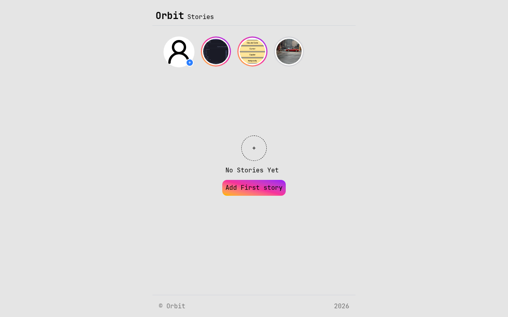

# Stories Feature — Instagram Story Clone

A client-side stories feature: a tray of story circles at the top, a plus button
to upload an image, and a full-screen viewer that steps through stories one at a
time. Stories are stored as base64 images in `localStorage` and disappear after
24 hours. A solution for **Advanced Project #1 (Stories Feature)** from
[roadmap.sh](https://roadmap.sh/projects/stories-feature).

## Screenshots

### Desktop



## Tech Stack

- **React 19** - UI library
- **Vite 8** - build tool and dev server
- **React Router 8** - routing, including the dynamic `/stories/:id` route
- **Tailwind CSS v4** - utility-first styling via `@tailwindcss/vite`
- **lucide-react** - icons
- **localStorage** - client-side persistence for stories
- **ESLint** - linting

## Features

- Story tray with an always-first "add" circle and a horizontally scrollable
  list of story thumbnails
- Add-story sheet: pick an image, preview it, post it (or cancel)
- Images converted to base64 with `FileReader` and stored in `localStorage`
- 24-hour expiry: stories older than a day are filtered out and rewritten to
  storage on every app load
- Full-screen story viewer at `/stories/:id` with previous/next navigation,
  disabled buttons at the ends, and click-outside to close
- Viewed stories lose their gradient ring (grey ring instead)
- Invalid or expired story links redirect back to `/`
- Empty state with an "Add First story" call to action

## Architecture

```
src
├── app                # App (router provider + error boundary), router with routes
├── compnents          # layout shell: header, footer, error boundary/page
└── features
    └── stories        # the single feature
        └── components # story bar, story list, circle card, viewer,
                       # add sheet, upload button, empty state
```

State lives in the router (`Approuter`) and flows down: `/` renders the
homepage, `/stories/:id` renders the viewer, both receiving `stories` and
`setStories`.

## Routes

| Path          | Component   | Purpose                             |
| ------------- | ----------- | ----------------------------------- |
| `/`           | `Homepage`  | story tray + empty state + add sheet |
| `/stories/:id`| `Storyview` | full-screen viewer for one story    |

## What I Learned

This project was my lesson in **adding ids in the route path**:

- **Dynamic segments with `:id`** - a route can be declared as
  `path="/stories/:id"`, which means "match `/stories/` followed by *anything*"
  and hand that anything to the component. One route now serves every story
  instead of one route per story - I never create a new route when a story is
  posted, I only create a new URL by linking to it.
- **Reading the param with `useParams()`** - inside `Storyview`,
  `const { id } = useParams()` returns the exact string from the URL as an
  object. The component itself stays URL-agnostic: it gets `id`, finds the
  matching story with `stories.findIndex((s) => s.id === id)`, and renders it.
  The URL is the source of truth for *which* story is open.
- **Navigation is just a link to an id** - the circle cards render
  `<Link to={`/stories/${story.id}`}>`, and the prev/next buttons call
  `navigate(`/stories/${stories[index].id}`)`. Because each story has a
  `crypto.randomUUID()` id, every story gets a unique, shareable, refresh-safe
  URL - a plain index (`/stories/0`) would break the moment a story expires and
  the list shifts.
- **Deep links and refreshes work for free** - since the id lives in the path,
  pasting `/stories/<id>` in a new tab, hitting reload, or using the back
  button all resolve to the same story. Before route params I would have had to
  pass state around manually and would lose it on refresh.
- **Handling a param that no longer exists** - a story link can outlive its
  story (24-hour expiry). If `findIndex` returns `-1`, `Storyview` renders
  `<Navigate to="/" replace />` instead of crashing on `story.image` of
  `undefined`. `replace` matters: it swaps the dead URL out of history so Back
  doesn't loop between a broken link and the redirect.
- **`replace` navigation for the viewer** - moving between stories calls
  `navigate(url)` so each viewed story is a history entry (Back steps through
  stories), while the redirect uses `replace` so invalid entries never enter
  history. Same API, two different history behaviors.
- **One param, one side effect** - the viewer marks a story as `viewed` in a
  `useEffect` keyed on the id from `useParams`. Because the effect depends on
  the param, opening a story marks it once, and clicking next/next re-runs it
  for the new id without re-marking the old one.
- **Routes own app state** - `stories` is `useState` in `Approuter` above the
  `<Routes>`, so both `/` and `/stories/:id` read and write the same list
  without prop-drilling through the layout or duplicating state per route.
- **Expiry is checked at load, not with a timer** - `loadActiveStories()` runs
  once when state initializes, drops anything older than 24h from
  `localStorage`, and persists the trimmed list. No `setTimeout` left running;
  the data is simply re-validated every time the app opens.

## How to Run

```bash
npm install
npm run dev        # start dev server
npm run build      # production build
npm run preview    # serve the production build
npm run lint       # eslint
```

## Author

Abukiya - 2026