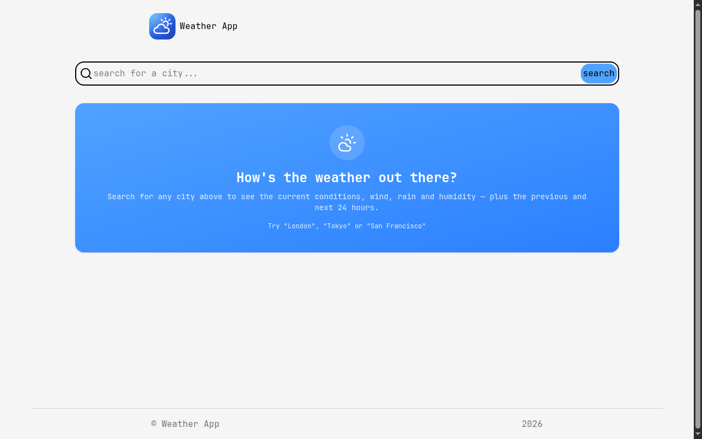

# Weather App

A weather search app that fetches live data from the Visual Crossing API - current conditions, wind, rain and humidity, plus hourly views of the previous and next 24 hours. A solution for **Intermediate Project #2 (Weather App)** from [roadmap.sh](https://roadmap.sh/projects/weather-app).

## Screenshots

### Desktop



## About

- `/` - search for a city and see the current weather overview, with links to the previous and next 24 hours
- `/hours/:city/:range` - hourly detail page, `range` is either `previous` or `next`

The search page keeps three pieces of state: `isloading`, `error`, and `weather`. Only one of the welcome card, skeleton, error message, or weather overview is rendered at a time, so the UI always reflects the real request status.

The hourly page requests the full timeline once, flattens `days[].hours[]` into a single sorted list, then slices the 24 entries before or after the current hour depending on the route. It wraps the fetch in an `AbortController` and aborts in the effect cleanup, so navigating away cancels the request instead of leaving it to resolve into a dead component.

Routes are wrapped in an `ErrorBoundary` so a crash in the hourly view renders an error page instead of blanking the whole app.

## Tech Stack

- **React 19** - UI library
- **Vite 8** - build tool and dev server
- **React Router 8** - routing with `useParams` and `useNavigate`
- **Tailwind CSS v4** - utility-first styling via `@tailwindcss/vite`
- **Recharts** - temperature trend chart
- **lucide-react** - icons
- **ESLint** - linting
- **Visual Crossing Weather API** - REST API for weather data

## What I Learned

This project was my deep dive into **APIs**:

- **Anatomy of a REST request** - a URL is just a base endpoint plus path segments (`/timeline/{city}/{start}/{end}`) and query parameters. I built the query string with `URLSearchParams` so parameters are encoded and joined with `&` automatically.
- **Encoding user input** - the city goes through `encodeURIComponent()` because a raw string like `San Francisco` (or anything with `&`, `#`, `?`) would otherwise break the path or inject extra parameters.
- **`fetch` and async/await** - a request is asynchronous: `fetch` returns a promise, and I await it before touching the body. Everything downstream (state updates, rendering) has to happen after the promise settles.
- **Status codes matter** - `response.ok` is only true for 2xx, so I check it and read the error text with `await response.text()` before parsing success with `response.json()`. I then branch on `err.status` and the message text to turn raw API errors ("No valid locations", "too short") into friendly messages like "City not found. Check the spelling and try again."
- **Throwing and catching your own errors** - attaching `error.status` to the `Error` object lets the UI catch one error and still know which case it is, instead of receiving an opaque string.
- **Cancelling requests** - passing an `AbortSignal` into `fetch({ signal })` and calling `controller.abort()` in an effect cleanup cancels in-flight requests; the resulting `AbortError` is ignored instead of being shown as a failure.
- **API keys and environment variables** - the key lives in `.env.local` and is read with `import.meta.env.VITE_WEATHER_KEY`. Vite only exposes variables prefixed with `VITE_`, and `.env.local` is gitignored (`*.local`), so the secret never lands in the repository.
- **Loading and error states** - every request has three possible outcomes, so the UI renders a skeleton while loading, an error message on failure, and data on success - never all three at once.
- **Shaping API responses for the UI** - the API returns nested `days -> hours`, which the chart doesn't want. Flattening, sorting by timestamp, and then slicing 24 hours is a reminder that the raw response shape is the API's, not the UI's, and mapping between them is normal work.

## How to Run

The API key is required. Create a `.env.local` file in the project root:

```bash
VITE_WEATHER_KEY=your_visualcrossing_key
```

```bash
npm install
npm run dev      # start dev server
npm run build    # production build
npm run preview  # serve the build
```

## Author

Abukiya - 2026
