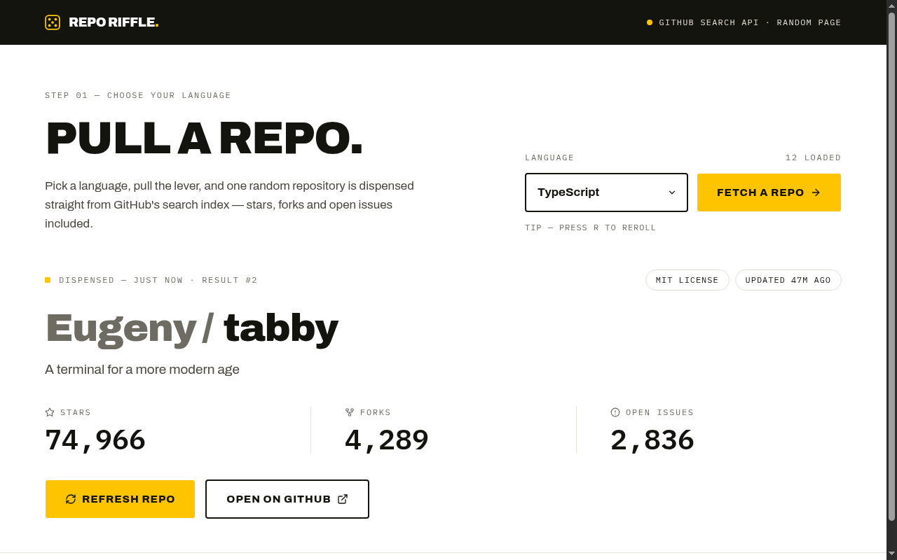

# Repo Riffle — GitHub Random Repository Finder

Pick a programming language, pull the lever, and one random repository is dispensed
from the GitHub Search API — stars, forks and open issues included. A solution for
**Intermediate Project #3 (GitHub Random Repo)** from [roadmap.sh](https://roadmap.sh/projects/github-random-repo).

Built from the "Repo Riffle" Paper design (signage mood: enamel white × screen-print
ink × chrome yellow) and structured following
[bulletproof-react](https://github.com/alan2207/bulletproof-react) (react-vite flavor).

## Screenshots

### Desktop



## About

- **Randomness** — rolls a random page of the first 1000 search results
  (GitHub's search cap) for `language:<value>`, then a random item on that page.
- **States** — `idle → loading → success | empty | error`, derived from the
  mutation status; the loading skeleton, empty picker and error panels replace
  the result surface in place.
- **Rate limits** — a 403 with `X-RateLimit-Remaining: 0` renders a live
  countdown until the quota resets; 422 responses (unknown language) surface
  the empty state.
- **Controls** — language select auto-dispenses on change, `FETCH A REPO`
  pulls again, a `REFRESH REPO` button appears after the first success, and
  pressing `R` anywhere rerolls.

## Architecture

```
src
├── app                # application layer: provider, shell (top bar), app root
├── components         # shared UI (button variants, theme provider)
├── lib                # pre-configured api client + query client
└── features
    └── random-repo    # the single feature
        ├── api        # request declaration: fetcher + react-query hook
        ├── components # hero, select, result, stats, footer, states
        ├── hooks      # R-key reroll shortcut
        ├── types.ts
        └── utils      # language list, formatting, randomization
```

Data flows one way (`shared → features → app`); the feature owns its API
declaration, state machine and UI.

## Tech Stack

- **React 19** - UI library
- **TypeScript** - type safety
- **Vite 8** - build tool and dev server
- **Tailwind CSS v4** - utility-first styling via `@tailwindcss/vite`
- **shadcn/ui (Base UI primitives)** - component primitives
- **TanStack Query** - mutation-based data fetching, caching and request state
- **lucide-react** - icons
- **Archivo** + **IBM Plex Mono** - display and data fonts
- **ESLint** + **Prettier** - linting and formatting
- **GitHub Search API** - REST API for repository data

## What I Learned

This project was my deep dive into **APIs**:

- **What an API is** - the GitHub Search API is just an HTTP contract: I send a
  `GET` request to `https://api.github.com/search/repositories` with parameters,
  and it answers with JSON. No database access, no server of my own - just a
  documented URL that both sides agree on.
- **Endpoints and query parameters** - the whole request lives in the query
  string: `q=language:TypeScript`, `sort`, `page`, `per_page`. I build it with
  `URLSearchParams` so values are encoded and joined with `&` automatically,
  which also means a language with odd characters can't corrupt the URL.
- **Fetching with `fetch` and async/await** - the request returns a promise, so
  every read of `response.json()` and every state update happens after it
  settles. Loading, success and error are not decorations - they are the three
  real outcomes of one asynchronous call.
- **Response status codes** - `response.ok` only covers 2xx, so I check it
  explicitly. The API answers `422` for an invalid search query (unknown
  language) and `403` when the quota is gone - each needs a different UI, so I
  branch on the status instead of guessing from the message text.
- **Reading response headers** - rate-limit errors ship `X-RateLimit-Remaining`
  and `X-RateLimit-Reset` headers. `fetch` exposes them through
  `response.headers.get(...)`, which turned "too many requests" into a live
  countdown until the quota resets.
- **Randomness inside API limits** - GitHub caps search at the first 1000
  results, so true random pick is impossible. I roll `page = random(1..10) x
  per_page` inside that window, then pick a random item on the page - a reminder
  that you work with the constraints an API documents, not around them.
- **Rate limits without a token** - unauthenticated requests get 60/hour, so I
  treat the API as a scarce resource: one request per roll, cache nothing I
  don't need, and surface the reset time rather than silently failing.
- **Shaping the response for the UI** - the API returns a big `items[]` object
  with dozens of fields; the UI wants owner, name, description, stars, forks,
  issues, license and push date. Mapping between the raw payload and a small
  typed `Repository` shape keeps the rest of the app unaware of GitHub's schema.
- **Request state as a machine** - with TanStack Query's mutation status the UI
  derives `idle → loading → success | empty | error`, so exactly one of the
  skeleton, result, empty picker or error panel is ever rendered. An API call is
  never "maybe showing data" - it always has one visible state.
- **No API key needed** - GitHub's search endpoint is public and CORS-enabled,
  so the browser calls it directly. That's the flip side of key management: open
  endpoints shift the cost to rate limits instead of secrets.

## How to Run

No API key needed — the GitHub Search API is public.

```bash
npm install
npm run dev        # start dev server
npm run build      # typecheck + production build
npm run preview    # serve the production build
npm run typecheck  # tsc --noEmit
npm run lint       # eslint
npm run format     # prettier --write
```

## Author

Abukiya - 2026
