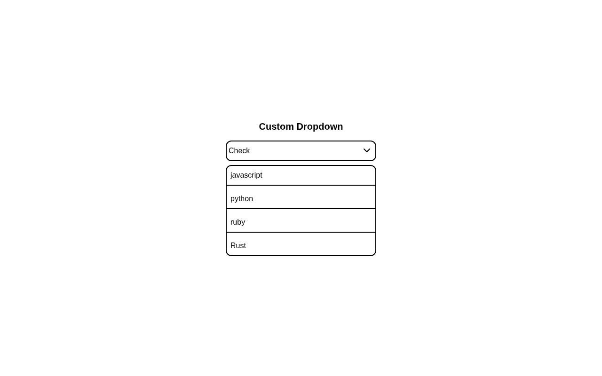

# Custom Dropdown

A custom-built dropdown select: clicking the button toggles the option list and swaps the chevron, clicking an option writes it into the button and closes the list, and each option reveals a checkmark on hover — no framework, no `<select>`. A solution for **Intermediate Project #4 (Custom Dropdown)** from [roadmap.sh](https://roadmap.sh/projects/custom-dropdown).

## Screenshots

### Desktop



## About

- The option list ships with the `hidden` class; a click on the wrapper toggles it and swaps `fa-chevron-down` for `fa-chevron-up`.
- Each option has its own click handler that copies its `.option-text` into the trigger button and hides the list again.
- The hover checkmark is pure CSS: every option row is a Tailwind `group`, and the checkmark uses `hidden group-hover:flex` to appear — JavaScript never learns about hovering.
- The checkmark is absolutely positioned against its `relative` option row, so it sits flush on the right no matter how long the label is.

## Tech Stack

- **HTML5** - semantic markup
- **Tailwind CSS v4** - utility-first styling via the `@tailwindcss/browser` CDN
- **Font Awesome 6** - chevron and checkmark icons
- **Vanilla JavaScript** - DOM toggling with `classList` and event listeners

## What I Learned

This project was my deep dive into the **Tailwind `group` class**:

- **Parent → child styling without JavaScript** - `group` is a hook, not a style: put `group` on a parent, then any descendant can react with `group-hover:*`. Tailwind compiles `group-hover:flex` into `.group:hover &`, so hovering the parent styles the child with zero JS and zero hover listeners.
- **The pair has to exist** - the checkmark is `hidden group-hover:flex`. Neither class does the job alone: `hidden` keeps it invisible at rest, `group-hover:flex` overrides it on hover. I had to remember that `hidden` is `display: none` and needs a display utility back, not an `opacity` tweak.
- **Groups are scoped per instance** - every option row declares its own `group`, so hovering one row reveals only that row's checkmark. Siblings stay clean because the selector is anchored to *its* parent — the reason I put `group` on each row instead of once on the list container.
- **It is just a generated descendant selector** - under the hood `group-hover:flex` means "when `.group` is hovered, apply `display: flex` to me". Seeing it as plain CSS made clear why the parent must be an *ancestor* of the target, and why `group` can live several levels up.
- **A class named twice is still one class** - `group` carries no styles of its own (it's an empty marker class). Adding it to a div that already has `relative cursor-pointer option` costs nothing and doesn't conflict with the utilities next to it.
- **Positioning matters for the child** - the checkmark is `absolute right-0 top-0`, which only works because the option row is `relative`. `group` controls *when* it appears; `relative`/`absolute` control *where*.
- **The same pattern scales** - `group` works with any variant, not just hover: `group-focus`, `group-open` (for `<details>` or dialogs), `group-has-*`. And for nested groups Tailwind has named groups (`group/row`, `group-hover/row`) so an inner hover doesn't accidentally trigger the outer one.
- **Where JS still belongs** - hover is presentation, so CSS owns it; open/close state and "which option is selected" are real state, so JavaScript owns those. Splitting the two kept `script.js` at ~26 lines instead of a pile of `mouseenter`/`mouseleave` handlers.

## How to Run

No build tools needed. Just open `index.html` directly in a browser.

```bash
# Using a local server (optional)
npx serve .
```

## Author

Abukiya - 2026
