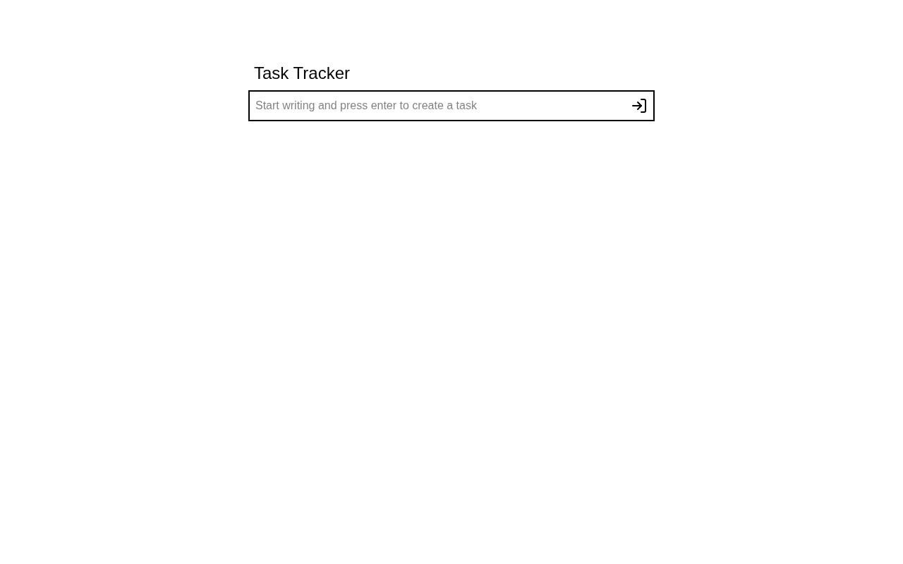

# Task Tracker

A small to-do app where you add tasks, mark them done, and delete them — completed
tasks get a strikethrough and can be toggled back. A solution for **Intermediate
Project #5 (Task Tracker)** from [roadmap.sh](https://roadmap.sh/projects/task-tracker-js).

## Screenshots

### Desktop



## Tech Stack

- **React 19** - UI library, with `useState` driving all task state
- **Vite 8** - build tool and dev server
- **Tailwind CSS v4** - utility-first styling via `@tailwindcss/vite`
- **lucide-react** - check, submit and trash icons
- **ESLint** - linting

## What I Learned

This project was my hands-on lesson in **playing with arrays in React**:

- **Arrays as state** - the whole app is one array of task objects in state:
  `{ id, text, done }`. Every button on the screen is just a way to produce a
  *new* version of that array, and React re-renders whatever the current array is.
- **Rendering an array with `.map()`** - I turn the task array into JSX by mapping
  each task to an `<li>`. The list on screen is a direct projection of the data, so
  I never touch the DOM by hand.
- **Why `key` matters** - each `<li>` gets `key={todo.id}` so React can tell items
  apart when the array changes order or shrinks, instead of reusing the wrong row.
- **Adding immutably** - a new task is prepended with a spread:
  `setTodos([{ id: Date.now(), text, done: false }, ...todos])`. Pushing with
  `.push()` would mutate state React can't see, so the spread makes a fresh array.
- **Removing with `.filter()`** - deleting is `todos.filter((todo) => todo.id !== id)`,
  which returns a new array with that one task left out.
- **Toggling with `.map()` and spread** - flipping `done` is `prev.map((todo) =>
  todo.id === id ? { ...todo, done: !todo.done } : todo)`: copy the array, copy only
  the matching object, leave everything else alone.
- **Functional updates** - for `toggleTodo` I use `setTodos((prev) => ...)` so the
  update is based on the latest state, not a value captured in the closure.
- **Keeping state atomic** - add, remove and toggle each change the array in one
  step, so the UI can never catch it half-updated.

## How to Run

```bash
npm install
npm run dev        # start dev server
npm run build      # production build
npm run preview    # serve the production build
npm run lint       # eslint
```

## Author

Abukiya - 2026
