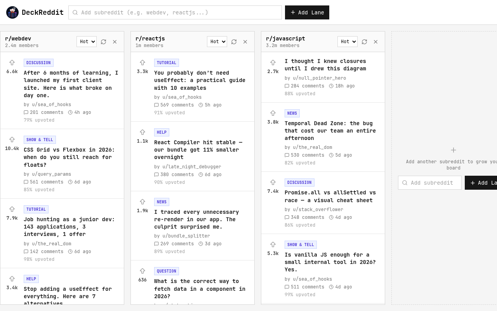

# Reddit Client (DeckReddit)

A multi-lane Reddit client that shows several subreddits side by side as
customizable lanes on a single board (a Trello-style dashboard for Reddit
feeds). A solution for **Intermediate Project #6 (Reddit Client)** from
[roadmap.sh](https://roadmap.sh/projects/reddit-client).

Because Reddit no longer allows anonymous access to its JSON feeds, the app
runs on a local **mock API** that mimics the real one — artificial latency,
"subreddit not found" errors, occasional network failures and deterministic
posts that survive reloads.

## Screenshots

### Desktop



## Tech Stack

- **React 19** - UI library, with a Context provider for lane state
- **Vite 8** - build tool and dev server
- **React Router 8** - routing with an error boundary and a 404 catch-all
- **Tailwind CSS v4** - utility-first styling via `@tailwindcss/vite`
- **lucide-react** - icons
- **ESLint** - linting

## Features

- Add lanes by subreddit name, validated against the API with inline errors
- Per-lane Hot / New / Top sorting, manual refresh and one-click removal
- Loading skeletons, error cards with retry, and a friendly empty state
- Board (including sort order) persisted to `localStorage`, sanitized on read
- Responsive horizontally scrolling snap board

## What I Learned

This project was my hands-on lesson in **how to use AI while building**:

- **Prompt with context** - vague questions get vague answers. Describing the
  goal, the constraints, and pasting the relevant file produced far more
  useful output than "write me a component".
- **AI as a pair programmer, not an autopilot** - I let it scaffold hooks,
  components and boilerplate, then reviewed every generated line before
  keeping it. Typing speed is the part it automates; the design decisions
  stayed mine.
- **Verify everything** - AI confidently suggests plausible-but-wrong code
  (like mutating state directly instead of spreading). Running
  `npm run lint`, `npm run build` and the app itself is what catches it, so
  the checks are now a fixed step after every AI-assisted change.
- **Ask "why", not just "how"** - asking it to explain unfamiliar patterns
  (custom hooks, context providers, feature-first architecture) turned AI
  output into actual understanding instead of cargo-culted code.
- **Iterate in small steps** - one feature per prompt, check the result in
  the browser, then continue. Big "build the whole app" prompts were where
  quality collapsed.
- **Use AI for repetitive, rules-based work** - this README, its screenshot
  and the catalog tables in this repo were generated by a custom AI skill
  (`.opencode/skills/write-readme/`), which is exactly the kind of mechanical
  task AI is genuinely good at.

## How to Run

```bash
npm install
npm run dev        # start dev server
npm run build      # production build
npm run preview    # serve the production build
npm run lint       # eslint
```

## Mock Data

All data flows through one file: `src/features/lanes/api/mock-reddit-api.js`
(`verifySubreddit` + `fetchSubredditPosts`). Reimplement those two functions
against a real API or proxy and nothing else changes. Edit the registry in
`src/features/lanes/api/mock-data.js` to add mock subreddits.

## Author

Abukiya - 2026
