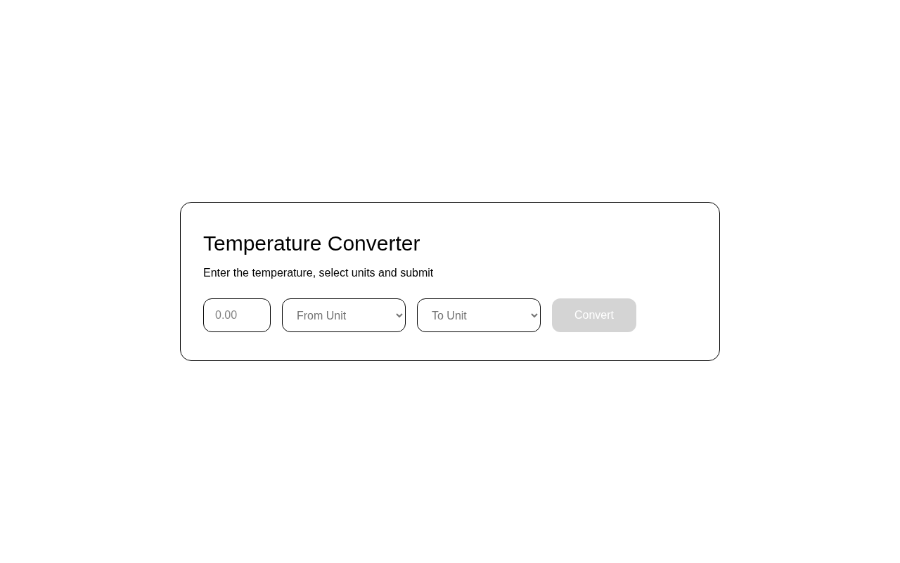

# Temperature Converter

A temperature converter that converts between **Celsius**, **Fahrenheit** and
**Kelvin**. A solution for **Intermediate Project #7 (Temperature Converter)**
from [roadmap.sh](https://roadmap.sh/projects/temperature-converter).

Pick a value, choose the *from* and *to* units, hit **Convert**, and the result
appears below the form. The button stays disabled until all three fields are
filled in.

## Screenshots

### Desktop



## Tech Stack

- **React 19** - UI library, with controlled form inputs via `useState`
- **Vite 8** - build tool and dev server
- **Tailwind CSS v4** - utility-first styling via `@tailwindcss/vite`
- **ESLint** - linting

## Features

- Convert between any pair of Celsius / Fahrenheit / Kelvin
- Convert button disabled until the value and both units are provided
- Validation for non-numeric input and for Kelvin below absolute zero
- Conversion math isolated in `src/converter.js` (two-step via Celsius)
- Accessible output: `role="alert"` on errors, `aria-live="polite"` on results
- `aria-label`s on every control so the form is readable to screen readers

## Requirements

From the roadmap.sh brief:

- Enter a temperature value, select the *from* and *to* units
- The **Convert** button is only enabled when all three fields are filled in
- Display the converted temperature below the form

All three are implemented, plus extra validation and accessibility polish.

## How It Works

The whole page is a single `<form>` with `onSubmit={handleSubmit}`. The
conversion itself lives in one exported function:

```js
// src/converter.js
convertTemperature(value, fromUnit, toUnit);
// 1. normalize the input to Celsius
// 2. convert Celsius to the target unit
```

Routing everything through Celsius keeps the math to six lines instead of a
nine-cell lookup table of every unit pair.

## What I Learned

This project was my lesson in **forms and `onSubmit`** in React:

- **`onSubmit` on the `<form>`, not `onClick` on the button** - putting the
  handler on the form means pressing **Enter** in the text input submits too.
  A `onClick`-only button would miss that, and keyboard users would be stuck.
- **`e.preventDefault()` is mandatory** - without it, submitting a form does
  the browser's default action: a full page reload that throws away all the
  React state. The first version "worked" but flashed and reset every time.
- **Submit buttons need `type="submit"` explicitly** - in plain HTML a button
  inside a form defaults to `type="submit"`, but it is easy to assume and
  then wonder why nothing fires. I set it explicitly now.
- **Controlled inputs mean state and the DOM agree** - every input is
  `value={...}` + `onChange={(e) => ...}`. React is the single source of
  truth, so validation can read the same values the user sees.
- **The disabled state doubles as validation** - `isReady` is one boolean
  (`value` non-empty *and* both units chosen) that disables the button **and**
  guards `handleSubmit`. Doing both from the same expression keeps them from
  drifting apart.
- **Validate in the handler, not just in the UI** - `parseFloat` can return
  `NaN` for input the browser accepts, and Kelvin can never be negative. Both
  are checked in `handleSubmit` before any math runs, and the error is shown
  with `role="alert"` so it is announced, not just colored red.
- **Reset stale errors when new results arrive** - clearing `result` on an
  error and vice versa prevents an old message from lingering next to fresh
  output.

## How to Run

```bash
npm install
npm run dev        # start dev server
npm run build      # production build
npm run preview    # serve the production build
npm run lint       # eslint
```

## Author

Abukiya - 2026
