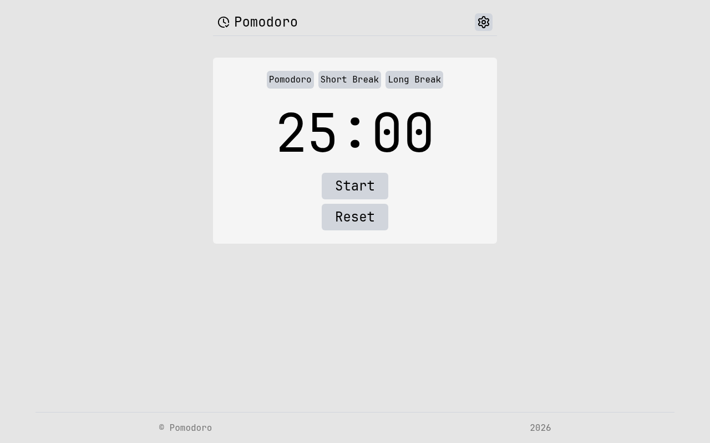

# Pomodoro Timer

A pomodoro timer with three session modes and a settings page for the interval
lengths. A solution for **Intermediate Project #8 (Pomodoro Timer)** from
[roadmap.sh](https://roadmap.sh/projects/pomodoro-timer).

Pick **Pomodoro**, **Short Break** or **Long Break**, hit **Start**, and the
countdown runs down to `00:00`. The gear icon in the header opens a settings
page where the three default durations can be changed.

## Screenshots

### Desktop



## Tech Stack

- **React 19** - UI library, with `useState` for timer and settings state
- **Vite 8** - build tool and dev server
- **React Router 8** - two routes (`/` and `/setting`) inside a shared layout
- **Tailwind CSS v4** - utility-first styling via `@tailwindcss/vite`
- **lucide-react** - icons (clock, settings, timer, close)
- **ESLint** - linting

## Features

- Three session modes: Pomodoro (25 min), Short Break (5 min), Long Break (15 min)
- Start / Pause / Reset controls on a zero-padded `mm:ss` display
- Deadline-based countdown (`endTimeRef`) so the timer does not drift while running
- Settings page at `/setting` to override all three interval lengths
- Shared layout route with header navigation and footer
- Error boundary wrapping the router, plus an error page for unknown routes

## Requirements

From the roadmap.sh brief:

- Start, stop and resume a pomodoro timer - **done** (`start` / `pause` / `reset`)
- Configure the default intervals (25 / 5 / 15 minutes) - **done** (settings form)
- Display the current session type - **done** (the three mode tabs)
- Track the number of completed work sessions - **not yet**
- Play a sound when a session ends - **not yet** (`useCountdown` already calls an
  `onComplete` callback at `00:00`, so the hook is ready for it)
- Accessible and visually appealing on desktop and mobile - **partially**
  (labels exist on the settings inputs; responsive layout still needs work)

## How It Works

The timer state lives in one custom hook, and the mode tabs decide how long that
state is seeded for:

```js
// src/features/homepage/countdown.js
useCountdown(totalSeconds, onComplete);
// -> { secondsLeft, isRunning, start, pause, reset }
```

Instead of ticking a counter down by one every second, `start` stores a target
end time in a ref (`Date.now() + secondsLeft * 1000`) and the interval recomputes
the remaining time from the clock. That way a throttled background tab or a slow
render cannot make the timer lose seconds - it always knows what wall-clock time
it is supposed to end at.

```jsx
// src/features/homepage/pomodoro.jsx
<Display key={taptime} selectedtaptime={taptime} />
```

## What I Learned

This project was my lesson in **`key` and component identity** in React:

- **Changing a `key` remounts the component.** `key={taptime}` sits on
  `<Display>`, so clicking *Short Break* does not update the existing display -
  it throws the old one away and mounts a fresh one. That is exactly what I
  wanted: `useCountdown` seeds `useState(totalSeconds)` only on mount, so a
  remount is what resets a running 25:00 countdown down to 05:00.
- **Without the key, nothing would have reset.** React reconciles by position in
  the tree. `<Display>` in the first render and `<Display>` in the second render
  are the same slot, so React keeps the component and all of its state. The
  result would have been the *Short Break* tab showing a leftover `25:00` timer.
- **Keys are about identity, not just lists.** I only ever saw `key` used inside
  `.map()` before. The rule is really "React uses the key to decide whether this
  is the same element as last time" - in a list that prevents state from
  hopping between rows, and outside a list it lets me deliberately force a
  fresh start.
- **The key must be unique among its siblings.** `taptime` works here because it
  is the only `<Display>` rendered. Two siblings with the same key is an error,
  not a coincidence React tolerates.
- **Index keys are a trap.** If I had written `key={0}` or `key={index}` in a
  list, React would match old and new items by position, so state (a focused
  input, an open accordion) would stick to the *slot* instead of the *item*
  whenever the list reorders or an item is removed.
- **Remounting is a real cost, not a free "reset button".** A new key means all
  state is lost and every effect runs again (cleanup, then setup). It is the
  right tool when the old state is genuinely invalid - a different timer mode -
  but the wrong tool for state I want to preserve across renders.
- **Keys are how reconciliation stays fast.** React builds a map of keys to
  nodes instead of comparing every old child to every new child, turning the
  match step from O(n²)-ish into roughly O(n).

## How to Run

```bash
npm install
npm run dev        # start dev server
npm run build      # production build
npm run preview    # serve the production build
npm run lint       # eslint
```

## Author

Abukiya - 2026
