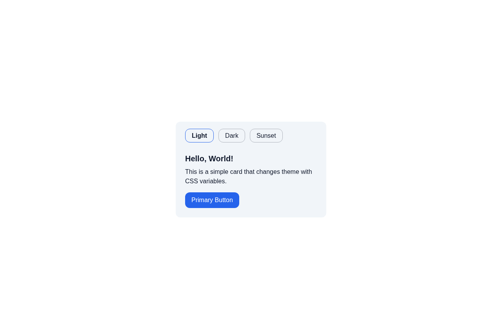

# Theme Switcher

A theme switcher that repaints one preview card three different ways without
touching its markup. A solution for **Intermediate Project #9 (Same markup,
different theme)** from [roadmap.sh](https://roadmap.sh/projects/theme-switcher).

Pick **Light**, **Dark** or **Sunset** and the whole card changes - background,
surface, text color, accent and even the corner radius. There is exactly one
card in the HTML; every theme is just a different set of values behind the same
five CSS variable names.

## Screenshots

### Desktop



## Tech Stack

- **React 19** - renders the markup (the theme logic itself is pure CSS)
- **Vite 8** - build tool and dev server
- **Tailwind CSS v4** - utility-first styling via `@tailwindcss/vite`
- **CSS custom properties + `:has()`** - the actual theme engine
- **ESLint** - linting

## Features

- Three themes: Light (default), Dark, and a custom Sunset theme
- Theme switch works with zero JavaScript - radio inputs plus `:has()`
- Keyboard accessible switcher: arrow keys move between radios, a visible
  focus ring shows the active option
- Token-driven card - not a single hardcoded color outside the token layer
- One markup tree shared by all themes; no card duplicated per theme
- Radius token too, so Sunset feels rounder, not just differently colored

## Requirements

From the roadmap.sh brief:

- At least three themes defined - **done** (light, dark, sunset)
- No JavaScript allowed for the switching - **done** (React only renders the
  markup; the swap itself is 100% CSS)
- Switcher controls visible and keyboard accessible - **done** (`sr-only`
  radios inside a `fieldset` with real `<label>`s)
- Every theme defines the same token names - **done** (all five tokens are
  redefined in each variant)
- Keep the markup the same - **done** (one `<article>`, restyled in place)
- No hardcoded colors outside the token layer - **done**

## How It Works

All the theming power comes from a tiny token layer declared once at `:root`,
and from the components never knowing any actual color values:

```css
/* src/index.css */
:root {
  --color-bg: #ffffff;
  --color-surface: #f1f5f9;
  --color-text: #0f172a;
  --color-accent: #2563eb;
  --radius-md: 0.75rem;
}
```

Each theme then redefines those exact names, keyed off which radio is
checked. `:has()` is what makes it possible to look *down* into the DOM from
the root and react to a single input's state:

```css
:root:has(#theme-dark:checked) {
  --color-bg: #0f172a;
  --color-surface: #1e293b;
  --color-text: #f8fafc;
  --color-accent: #38bdf8;
  --radius-md: 0.75rem;
}
```

The switcher is nothing but three radios in one `name` group, visually hidden
and dressed up by their labels:

```jsx
// src/themeswitcher.jsx
<input type="radio" name="theme" id={`theme-${id}`} className="peer sr-only"
       defaultChecked={id === "light"} />
<label htmlFor={`theme-${id}`}
       className="peer-checked:border-(--color-accent) peer-checked:font-semibold
                  peer-focus-visible:ring-2 peer-focus-visible:ring-(--color-accent)">
```

## What I Learned

This project was my lesson in **design tokens, CSS state and what a theme
actually is**:

- **Tokens are a contract, not a palette.** `--color-bg` is not "the
  background color" - it is the *promise* that something on screen has a
  background. Components consume the promise; themes decide what it resolves
  to. Once the card only speaks in token names, restyling it became a
  stylesheet-only change.
- **A theme is a redefinition, not a copy.** The naive approach is one card
  per theme and show/hide logic. Here there is one `<article>` and three
  blocks of variable assignments - the themes differ in *values*, never in
  *structure*, so adding a fourth theme means adding four lines of CSS and
  one radio, not another copy of the markup.
- **Every theme must fulfill the whole contract.** The token names have to be
  redefined as a complete set in each variant. If one theme forgot
  `--color-accent`, the declarations using it would become invalid at
  computed-value time rather than quietly falling back - the safest rule is
  "same names, same set, different values".
- **`:has()` lets the root react to a descendant.** Radios live inside a
  `fieldset` deep in the body, but `:root:has(#theme-dark:checked)` styles
  the `<html>` element based on one of its descendants. Before `:has()`, this
  needed the `~` sibling hack with the switcher artificially placed before the
  card in the source order. `:has()` turned "is this input checked?" into a
  condition any ancestor can depend on - essentially "CSS state with scope".
- **Radio groups are free state machines.** One shared `name="theme"` gives
  mutual exclusivity, the browser-managed "only one checked" rule, arrow-key
  navigation and screen-reader semantics - all for zero JavaScript. I did not
  need a `useState` holding the current theme, and adding one would only have
  duplicated state the browser already keeps.
- **`peer-checked` is the same trick in utility form.** The label styles
  itself off its previous sibling input using Tailwind's `peer-*` variants.
  It reads like component logic, but it is still plain CSS sibling/`:has()`
  selectors under the hood - the active pill border and bold text come from
  the input's `:checked` state, not from a render pass.
- **Hide the input, never the control.** `sr-only` hides the radio *visually*
  but keeps it focusable and announced, while the `<label>` becomes the thing
  a mouse clicks. Both the native radio and the styled label remain usable,
  and `peer-focus-visible:ring-2` restores the focus indicator that visually
  hidden inputs lose.
- **`defaultChecked` beats `checked` here.** With no controlled state I want
  the browser to own the value, so the initial theme is just a default and
  React never fights the user's clicks. An uncontrolled input matches the
  "the DOM is the state" philosophy of the whole project.
- **Tokens carry more than color.** `--radius-md` is redefined too, so the
  Sunset theme gets noticeably rounder corners. Once I was thinking in
  tokens, "theme" stopped meaning "different colors" and started meaning
  "different mood" - spacing, radii, even shadows could ride the same switch.
- **Contrast is per-theme, not global.** The button uses
  `text-(--color-bg)` on `--color-accent`, so it automatically flips to dark
  text in the dark theme and stays legible in every variant - pairing tokens
  that reference each other keeps contrast correct as themes change.

## How to Run

```bash
npm install
npm run dev        # start dev server
npm run build      # production build
npm run preview    # serve the production build
npm run lint       # eslint
```

## Author

Abukiya - 2026
